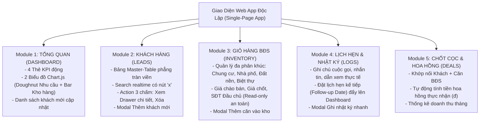

# BẢN ĐẶC TẢ SẢN PHẨM TOÀN DIỆN (MASTER PRD)
## HỆ THỐNG QUẢN LÝ KHÁCH HÀNG & GIỎ HÀNG BẤT ĐỘNG SẢN PRO – WEB APP
> **Thương hiệu:** File Đi Làm · CRM Bất Động Sản Pro  
> **Mô hình triển khai:** Google Sheets Database + Google Apps Script Web App (Tất cả mã nguồn HTML/CSS/JS gói gọn trong **1 file `Index.html` duy nhất**, kết nối API với `Mã.gs`).

---

## 1. MỤC TIÊU & ĐỐI TƯỢNG SỬ DỤNG
- **Đối tượng:** Môi giới cá nhân, sale BĐS độc lập, trưởng nhóm nhỏ (bán đa dạng phân khúc: Căn hộ chung cư, Nhà phố thổ cư, Đất nền dự án, Biệt thự/Shophouse).
- **Mục đích:** Thay thế hoàn toàn việc ghi chép sổ tay, app ghi chú điện thoại hoặc nhập Excel thủ công dễ xóa nhầm công thức và lộ dữ liệu khi dẫn khách.
- **Trải nghiệm mua hàng (`/copy`):** Người dùng nhận link Google Sheet `/copy` $\rightarrow$ bấm bản sao về Drive của họ $\rightarrow$ mở tab `BẮT ĐẦU` có sẵn nút bấm mở Web App $\rightarrow$ dùng ngay trên cả máy tính lẫn điện thoại mà không cần cài đặt.

---

## 2. KIẾN TRÚC DỮ LIỆU GOOGLE SHEETS (DATABASE NỀN)
File Sheet gồm 2 tab mặt tiền hiển thị và 5 tab database phẳng:
1. **`BẮT ĐẦU` (Landing page):** Tone pastel kem bơ/hồng phấn, có dải hướng dẫn 4 bước sử dụng và nút nổi bật `MỞ ỨNG DỤNG BĐS CRM`.
2. **`TỔNG QUAN` (Báo cáo tự động):** 4 thẻ KPI động (Khách đang chăm, Lịch hẹn hôm nay, Căn đang bán, Hoa hồng tháng) + Biểu đồ cơ cấu.
3. **`DB_KHACH_HANG`:** Cột: `Mã Khách` | `Họ Và Tên` | `Số Điện Thoại` | `Nhu Cầu` | `Khoảng Giá` | `Khu Vực` | `Căn Quan Tâm` | `Trạng Thái` | `Ghi Chú` | `Ngày Tạo`.
4. **`DB_GIO_HANG`:** Cột: `Mã Căn` | `Loại Hình` | `Địa Chỉ / Tên Dự Án` | `Diện Tích (m2)` | `Giá Chào (Triệu)` | `SĐT Chủ / Đầu Chủ` | `Trạng Thái` | `Hoa Hồng (%)` | `Ghi Chú`.
5. **`DB_NHAT_KY`:** Cột: `Mã Nhật Ký` | `Mã Khách` | `Tên Khách` | `Ngày Tương Tác` | `Hình Thức` | `Nội Dung Trao Đổi` | `Lịch Hẹn Tiếp`.
6. **`DB_GIAO_DICH`:** Cột: `Mã Hợp Đồng` | `Mã Khách` | `Mã Căn` | `Giá Chốt (Triệu)` | `Tỷ Lệ Hoa Hồng (%)` | `Hoa Hồng Thực Nhận (đ)` | `Ngày Chốt` | `Trạng Thái`.
7. **`CAI_DAT`:** Nhóm cài đặt và tham số hệ thống.

---

## 3. CẤU TRÚC 5 MODULE CỐT LÕI TRÊN GIAO DIỆN WEB APP



---

## 4. QUY CHUẨN THIẾT KẾ UI/UX FINTECH (THEO HIẾN PHÁP DỰ ÁN)

### 4.1. Màu Sắc & Typography
- **Màu chủ đạo:** Xanh ngọc Mint Emerald (`#059669` / `#10b981`), nền xám slate trung tính (`#F8FAFC`, `#E2E8F0`).
- **Font chữ:** `Inter` cho nội dung thường; `JetBrains Mono` cho tất cả các mã SKU định danh (`KH-XXXXXX`, `BDS-XXXXXX`, `LOG-XXXXXX`, `HĐ-XXXXXX`).
- **CẤM EMOJI TRẺ CON:** Tuyệt đối không gắn emoji (✨, ⚡, 🔑, 🏠, 📞) vào nút bấm hay tiêu đề bảng. Dùng 100% SVG Icon Lucide thanh mảnh đơn sắc.

### 4.2. Bảng Dữ Liệu (Master-Detail Table Standard)
- **Edge-to-Edge Full-Bleed:** Bảng phẳng tràn viền, **tuyệt đối không dùng đường kẻ dọc cột Excel**, chỉ dùng đường viền ngang siêu mảnh (`border-b border-slate-100`).
- **Cố định tiêu đề (Freeze Panes):** Tiêu đề cột `<th>` ghim cố định trên đỉnh khi cuộn danh sách hàng trăm dòng.
- **Triệt tiêu "Lậm Card & Lậm Pill":** Không đóng khung pill bo tròn màu mè cho các trường dữ liệu bình thường. Mã ID hiển thị text mono phẳng; trạng thái chỉ dùng chấm tròn nhỏ (`•`) tinh tế.
- **Action Menu 3 chấm (`MoreVertical`):** Nằm ở cột ngoài cùng bên phải, tiêu đề `<th>` để rỗng. CẤM gắn sự kiện click vào cả dòng `<tr>` để tránh click nhầm khi bôi đen copy chữ.

### 4.3. Thanh Công Cụ (Single-Row Toolbar)
- Cố định trên đỉnh, toàn bộ: `[Nút Hamburger]` $\rightarrow$ `[Tên module]` $\rightarrow$ `[Ô Search có nút 'x' xóa nhanh]` $\rightarrow$ `[Nút '+ Thêm Mới']` nằm trên **cùng 1 hàng duy nhất**. Tuyệt đối không chèn thẻ `<h1>` hay đoạn `<p>` dài dòng làm tụt diện tích hiển thị bảng.

### 4.4. Phân Định 2 Trải Nghiệm: Desktop View vs Mobile View
1. **Trên Desktop:** Sidebar cố định bên trái (240px) có nút Hamburger thu gọn về dạng Icon-only (64px). Màn hình xem chi tiết mở dạng **Drawer trượt từ bên phải** (chiếm 450px) để vừa xem chi tiết vừa đối chiếu bảng bên trái.
2. **Trên Mobile (Điện thoại):** 
   - **Table-to-Card Transformation:** Tuyệt đối CẤM bắt người dùng vuốt ngang màn hình tìm cột. Bảng tự động xếp thành các khối thẻ phẳng tinh gọn với link gọi điện 1 chạm (`tel:`).
   - **Thanh Dock dưới đáy (Bottom Navigation):** Ghim 4 tab chính cố định ở đáy màn hình trong tầm với ngón tay cái.
   - **Nút nổi FAB (Floating Action Button):** Nút tròn nổi màu Mint xanh ở góc dưới bên phải (`fixed bottom-20 right-4`) để thao tác 1 chạm bằng 1 tay.

---

## 5. BẢNG MÃ NGUỒN HOÀN CHỈNH: TẤT CẢ TRONG 1 FILE `Index.html` DUY NHẤT

Dưới đây là mã nguồn trọn vẹn của file **`Index.html`** tích hợp toàn bộ HTML, CSS Tailwind, Thư viện Chart.js, Icon Lucide và JavaScript API. Người làm tiếp theo **chỉ cần copy toàn bộ đoạn mã bên dưới và dán đè vào file `Index.html` trong Google Apps Script là Web App chạy full 100%**:

```html
<!DOCTYPE html>
<html lang="vi">
<head>
  <meta charset="UTF-8">
  <meta name="viewport" content="width=device-width, initial-scale=1.0, maximum-scale=1.0, user-scalable=no">
  <title>CRM Bất Động Sản Pro · File Đi Làm</title>

  <!-- Google Fonts Inter & JetBrains Mono -->
  <link rel="preconnect" href="https://fonts.googleapis.com">
  <link rel="preconnect" href="https://fonts.gstatic.com" crossorigin>
  <link href="https://fonts.googleapis.com/css2?family=Inter:wght@400;500;600;700&family=JetBrains+Mono:wght@500;600&display=swap" rel="stylesheet">

  <!-- Tailwind CSS CDN -->
  <script src="https://cdn.tailwindcss.com"></script>
  <script>
    tailwind.config = {
      theme: {
        extend: {
          colors: {
            brand: { 50: '#ECFDF5', 100: '#D1FAE5', 500: '#10B981', 600: '#059669', 700: '#047857' }
          },
          fontFamily: { sans: ['Inter', 'sans-serif'], mono: ['JetBrains Mono', 'monospace'] }
        }
      }
    }
  </script>

  <!-- Lucide Icons & Chart.js -->
  <script src="https://unpkg.com/lucide@latest"></script>
  <script src="https://cdn.jsdelivr.net/npm/chart.js"></script>

  <style>
    .no-scrollbar::-webkit-scrollbar { display: none; }
    .no-scrollbar { -ms-overflow-style: none; scrollbar-width: none; }
    .custom-scrollbar::-webkit-scrollbar { width: 5px; height: 5px; }
    .custom-scrollbar::-webkit-scrollbar-thumb { background: #CBD5E1; border-radius: 4px; }
    .table-row-hover:hover { background-color: #F8FAFC !important; box-shadow: inset 3px 0 0 0 #10B981; }
    .sticky-header th { position: sticky; top: 0; z-index: 20; background-color: #FFFFFF; border-bottom: 1px solid #E2E8F0; }
    .sidebar-collapsed { width: 64px !important; }
    .sidebar-collapsed .nav-label, .sidebar-collapsed .brand-name, .sidebar-collapsed .nav-section-title { display: none !important; }
    .sidebar-collapsed .nav-item-btn { justify-content: center !important; padding-left: 0 !important; padding-right: 0 !important; }
    .module-tab-content { display: none; }
    .module-tab-content.active { display: block; animation: fadeIn 0.2s ease-in-out; }
    @keyframes fadeIn { from { opacity: 0; transform: translateY(4px); } to { opacity: 1; transform: translateY(0); } }
  </style>
</head>
<body class="bg-slate-50 text-slate-900 font-sans h-screen flex overflow-hidden antialiased select-none">

  <!-- SIDEBAR DESKTOP -->
  <aside id="appSidebar" class="w-60 bg-white border-r border-slate-200 flex flex-col transition-all duration-200 z-40 flex-shrink-0 select-none hidden md:flex">
    <div class="h-14 px-4 border-b border-slate-100 flex items-center justify-between flex-shrink-0">
      <div class="flex items-center gap-2.5 min-w-0">
        <div class="w-8 h-8 rounded-lg bg-emerald-600 flex items-center justify-center text-white font-bold text-sm shadow-xs flex-shrink-0">F</div>
        <div class="brand-name flex flex-col min-w-0">
          <span class="text-xs font-bold text-slate-900 tracking-wider uppercase truncate">File Đi Làm</span>
          <span class="text-[10px] text-slate-400 font-medium truncate">CRM Bất Động Sản</span>
        </div>
      </div>
    </div>
    <nav class="flex-1 p-3 space-y-1 overflow-y-auto no-scrollbar">
      <div class="nav-section-title px-3 pt-2 pb-1 text-[10px] font-semibold text-slate-400 uppercase tracking-wider">Quản lý nghiệp vụ</div>
      <button onclick="switchTab('dashboard')" id="nav-dashboard" class="nav-item-btn w-full flex items-center gap-3 px-3 py-2.5 rounded-lg text-xs font-medium text-emerald-800 bg-emerald-50/70 transition-colors">
        <i data-lucide="layout-grid" class="w-4 h-4 text-emerald-600 flex-shrink-0"></i><span class="nav-label">Tổng quan</span>
      </button>
      <button onclick="switchTab('customers')" id="nav-customers" class="nav-item-btn w-full flex items-center gap-3 px-3 py-2.5 rounded-lg text-xs font-medium text-slate-600 hover:bg-slate-50 hover:text-slate-900 transition-colors">
        <i data-lucide="users" class="w-4 h-4 text-slate-400 flex-shrink-0"></i><span class="nav-label">Khách hàng</span>
      </button>
      <button onclick="switchTab('properties')" id="nav-properties" class="nav-item-btn w-full flex items-center gap-3 px-3 py-2.5 rounded-lg text-xs font-medium text-slate-600 hover:bg-slate-50 hover:text-slate-900 transition-colors">
        <i data-lucide="home" class="w-4 h-4 text-slate-400 flex-shrink-0"></i><span class="nav-label">Giỏ hàng BĐS</span>
      </button>
      <button onclick="switchTab('interactions')" id="nav-interactions" class="nav-item-btn w-full flex items-center gap-3 px-3 py-2.5 rounded-lg text-xs font-medium text-slate-600 hover:bg-slate-50 hover:text-slate-900 transition-colors">
        <i data-lucide="calendar" class="w-4 h-4 text-slate-400 flex-shrink-0"></i><span class="nav-label">Lịch hẹn & Nhật ký</span>
      </button>
      <button onclick="switchTab('deals')" id="nav-deals" class="nav-item-btn w-full flex items-center gap-3 px-3 py-2.5 rounded-lg text-xs font-medium text-slate-600 hover:bg-slate-50 hover:text-slate-900 transition-colors">
        <i data-lucide="badge-dollar-sign" class="w-4 h-4 text-slate-400 flex-shrink-0"></i><span class="nav-label">Chốt cọc & Hoa hồng</span>
      </button>
    </nav>
    <div class="p-3 border-t border-slate-100 flex items-center gap-2.5 flex-shrink-0">
      <div class="w-2 h-2 rounded-full bg-emerald-500"></div>
      <span class="text-[11px] text-slate-500 font-medium brand-name">Hệ thống sẵn sàng</span>
    </div>
  </aside>

  <!-- MOBILE BOTTOM DOCK -->
  <div class="md:hidden fixed bottom-0 left-0 right-0 h-14 bg-white border-t border-slate-200 flex items-center justify-around z-40 px-2 shadow-lg">
    <button onclick="switchTab('dashboard')" id="dock-dashboard" class="flex flex-col items-center gap-0.5 text-emerald-600 font-semibold text-[10px]"><i data-lucide="layout-grid" class="w-4 h-4"></i><span>Tổng quan</span></button>
    <button onclick="switchTab('customers')" id="dock-customers" class="flex flex-col items-center gap-0.5 text-slate-400 font-medium text-[10px]"><i data-lucide="users" class="w-4 h-4"></i><span>Khách</span></button>
    <button onclick="switchTab('properties')" id="dock-properties" class="flex flex-col items-center gap-0.5 text-slate-400 font-medium text-[10px]"><i data-lucide="home" class="w-4 h-4"></i><span>Giỏ hàng</span></button>
    <button onclick="switchTab('deals')" id="dock-deals" class="flex flex-col items-center gap-0.5 text-slate-400 font-medium text-[10px]"><i data-lucide="badge-dollar-sign" class="w-4 h-4"></i><span>Chốt cọc</span></button>
  </div>

  <!-- MAIN WORKSPACE -->
  <main class="flex-1 flex flex-col min-w-0 h-full overflow-hidden bg-white">
    <!-- TOOLBAR 1 HÀNG -->
    <header class="sticky top-0 z-30 h-14 bg-white border-b border-slate-200 px-4 flex items-center justify-between gap-3 flex-shrink-0 select-none">
      <div class="flex items-center gap-3 min-w-0">
        <button onclick="toggleSidebar()" class="p-2 rounded-lg text-slate-500 hover:text-slate-700 hover:bg-slate-100 transition-colors focus:outline-none"><i data-lucide="menu" class="w-4 h-4"></i></button>
        <div class="flex items-center gap-2 min-w-0">
          <span id="currentModuleTitle" class="text-xs sm:text-sm font-semibold text-slate-900 truncate">Tổng quan điều hành</span>
          <span class="hidden sm:inline-block text-slate-300">•</span>
          <span class="hidden sm:inline-block text-[11px] font-mono font-medium text-slate-400">CRM-V1.0</span>
        </div>
      </div>
      <div class="flex items-center gap-2.5">
        <div class="relative w-40 sm:w-64">
          <i data-lucide="search" class="w-3.5 h-3.5 text-slate-400 absolute left-3 top-1/2 -translate-y-1/2 pointer-events-none"></i>
          <input type="text" id="globalSearchInput" placeholder="Tìm kiếm nhanh..." onkeyup="handleSearchInput(this.value)" class="w-full h-8 pl-8 pr-7 bg-slate-50 border border-slate-200 rounded-lg text-xs text-slate-900 placeholder:text-slate-400 focus:bg-white focus:border-emerald-500 focus:outline-none transition-all">
          <button id="btnClearSearch" onclick="clearSearchInput()" class="hidden absolute right-2 top-1/2 -translate-y-1/2 p-0.5 text-slate-400 hover:text-slate-600 rounded-full"><i data-lucide="x" class="w-3 h-3"></i></button>
        </div>
        <button id="btnMainAction" onclick="handleMainAction()" class="hidden h-8 px-3 rounded-lg bg-emerald-600 hover:bg-emerald-700 text-white text-xs font-semibold flex items-center gap-1.5 shadow-xs transition-colors whitespace-nowrap">
          <i data-lucide="plus" class="w-3.5 h-3.5"></i><span id="btnMainActionText">+ Thêm Khách Hàng</span>
        </button>
      </div>
    </header>

    <!-- FLOATING ACTION BUTTON (MOBILE) -->
    <button onclick="handleMainAction()" class="md:hidden fixed bottom-20 right-4 w-12 h-12 rounded-full bg-emerald-600 hover:bg-emerald-700 text-white flex items-center justify-center shadow-lg shadow-emerald-600/30 z-30 transition-transform active:scale-95"><i data-lucide="plus" class="w-5 h-5"></i></button>

    <!-- CONTENT AREA -->
    <div class="flex-1 min-h-0 overflow-y-auto bg-slate-50/50 p-4 sm:p-6">
      
      <!-- MODULE 1: DASHBOARD -->
      <div id="module-dashboard" class="module-tab-content active space-y-5">
        <div class="grid grid-cols-2 lg:grid-cols-4 gap-3.5">
          <div class="bg-white border border-slate-200/90 rounded-xl p-4 shadow-xs">
            <div class="flex items-center justify-between"><span class="text-[11px] font-semibold text-slate-500 uppercase tracking-wider">Khách đang chăm</span><div class="w-2 h-2 rounded-full bg-emerald-500"></div></div>
            <div class="mt-2 flex items-baseline gap-2"><span class="text-2xl font-bold text-slate-900 tracking-tight" id="dashKpiCust">0</span><span class="text-[11px] text-slate-400 font-medium">người</span></div>
          </div>
          <div class="bg-white border border-slate-200/90 rounded-xl p-4 shadow-xs">
            <div class="flex items-center justify-between"><span class="text-[11px] font-semibold text-slate-500 uppercase tracking-wider">Lịch hẹn hôm nay</span><div class="w-2 h-2 rounded-full bg-blue-500"></div></div>
            <div class="mt-2 flex items-baseline gap-2"><span class="text-2xl font-bold text-slate-900 tracking-tight" id="dashKpiAppt">0</span><span class="text-[11px] text-slate-400 font-medium">lượt</span></div>
          </div>
          <div class="bg-white border border-slate-200/90 rounded-xl p-4 shadow-xs">
            <div class="flex items-center justify-between"><span class="text-[11px] font-semibold text-slate-500 uppercase tracking-wider">Nguồn hàng mở bán</span><div class="w-2 h-2 rounded-full bg-indigo-500"></div></div>
            <div class="mt-2 flex items-baseline gap-2"><span class="text-2xl font-bold text-slate-900 tracking-tight" id="dashKpiProp">0</span><span class="text-[11px] text-slate-400 font-medium">căn</span></div>
          </div>
          <div class="bg-white border border-slate-200/90 rounded-xl p-4 shadow-xs">
            <div class="flex items-center justify-between"><span class="text-[11px] font-semibold text-slate-500 uppercase tracking-wider">Hoa hồng tháng này</span><div class="w-2 h-2 rounded-full bg-amber-500"></div></div>
            <div class="mt-2 flex items-baseline gap-1"><span class="text-xl sm:text-2xl font-bold text-slate-900 tracking-tight" id="dashKpiComm">0</span><span class="text-xs font-semibold text-slate-400">đ</span></div>
          </div>
        </div>

        <div class="grid grid-cols-1 lg:grid-cols-2 gap-4">
          <div class="bg-white border border-slate-200/90 rounded-xl p-4 sm:p-5 shadow-xs flex flex-col">
            <div class="flex items-center justify-between mb-3 border-b border-slate-100 pb-2.5"><span class="text-xs font-semibold text-slate-800 uppercase tracking-wider">Cơ cấu nhu cầu khách</span><span class="text-[10px] text-slate-400 font-mono">Tỷ lệ %</span></div>
            <div class="relative flex-1 flex items-center justify-center min-h-[220px]"><canvas id="chartDemandCanvas"></canvas></div>
          </div>
          <div class="bg-white border border-slate-200/90 rounded-xl p-4 sm:p-5 shadow-xs flex flex-col">
            <div class="flex items-center justify-between mb-3 border-b border-slate-100 pb-2.5"><span class="text-xs font-semibold text-slate-800 uppercase tracking-wider">Phân bổ nguồn hàng BĐS</span><span class="text-[10px] text-slate-400 font-mono">Số lượng căn</span></div>
            <div class="relative flex-1 flex items-center justify-center min-h-[220px]"><canvas id="chartPropertyCanvas"></canvas></div>
          </div>
        </div>

        <div class="bg-white border border-slate-200/90 rounded-xl shadow-xs overflow-hidden">
          <div class="px-4 py-3 border-b border-slate-100 flex items-center justify-between">
            <span class="text-xs font-semibold text-slate-800 uppercase tracking-wider">Khách hàng cần quan tâm gần đây</span>
            <button onclick="switchTab('customers')" class="text-xs font-semibold text-emerald-600 hover:text-emerald-700">Xem tất cả →</button>
          </div>
          <div class="hidden sm:block overflow-x-auto">
            <table class="w-full text-left border-collapse">
              <thead><tr class="border-b border-slate-200 bg-slate-50/70 text-[11px] font-semibold text-slate-500 uppercase"><th class="px-4 py-3">Mã KH</th><th class="px-4 py-3">Họ và Tên</th><th class="px-4 py-3">Số Điện Thoại</th><th class="px-4 py-3">Nhu Cầu</th><th class="px-4 py-3">Khu Vực</th><th class="px-4 py-3">Trạng Thái</th></tr></thead>
              <tbody id="dashTableRecentCustomers" class="divide-y divide-slate-100 text-xs"><tr><td colspan="6" class="px-4 py-6 text-center text-slate-400">Đang đồng bộ dữ liệu...</td></tr></tbody>
            </table>
          </div>
          <div id="dashMobileRecentCustomers" class="sm:hidden p-3 space-y-2"></div>
        </div>
      </div>

      <!-- MODULE 2: KHÁCH HÀNG -->
      <div id="module-customers" class="module-tab-content space-y-4">
        <div class="hidden sm:block bg-white border border-slate-200/90 rounded-xl shadow-xs overflow-hidden">
          <div class="max-h-[calc(100vh-140px)] overflow-y-auto custom-scrollbar">
            <table class="w-full text-left border-collapse">
              <thead class="sticky-header">
                <tr class="bg-white text-[11px] font-semibold text-slate-500 uppercase tracking-wider">
                  <th class="px-4 py-3.5">Mã KH</th><th class="px-4 py-3.5">Họ Và Tên</th><th class="px-4 py-3.5">Số Điện Thoại</th><th class="px-4 py-3.5">Nhu Cầu</th><th class="px-4 py-3.5">Khoảng Giá</th><th class="px-4 py-3.5">Khu Vực</th><th class="px-4 py-3.5">Trạng Thái</th><th class="w-12 px-2 py-3.5 text-right"></th>
                </tr>
              </thead>
              <tbody id="tableCustomersBody" class="divide-y divide-slate-100 text-xs"><tr><td colspan="8" class="px-4 py-8 text-center text-slate-400">Đang tải danh sách khách hàng...</td></tr></tbody>
            </table>
          </div>
        </div>
        <div id="mobileCustomersList" class="sm:hidden space-y-2.5 pb-16"></div>
      </div>

      <!-- MODULE 3: GIỎ HÀNG BĐS -->
      <div id="module-properties" class="module-tab-content space-y-4">
        <div class="hidden sm:block bg-white border border-slate-200/90 rounded-xl shadow-xs overflow-hidden">
          <div class="max-h-[calc(100vh-140px)] overflow-y-auto custom-scrollbar">
            <table class="w-full text-left border-collapse">
              <thead class="sticky-header">
                <tr class="bg-white text-[11px] font-semibold text-slate-500 uppercase tracking-wider">
                  <th class="px-4 py-3.5">Mã Căn</th><th class="px-4 py-3.5">Loại Hình</th><th class="px-4 py-3.5">Địa Chỉ / Tên Dự Án</th><th class="px-4 py-3.5">Diện Tích</th><th class="px-4 py-3.5">Giá Chào</th><th class="px-4 py-3.5">SĐT Đầu Chủ</th><th class="px-4 py-3.5">Trạng Thái</th><th class="px-4 py-3.5">Hoa Hồng</th><th class="w-12 px-2 py-3.5 text-right"></th>
                </tr>
              </thead>
              <tbody id="tablePropertiesBody" class="divide-y divide-slate-100 text-xs"><tr><td colspan="9" class="px-4 py-8 text-center text-slate-400">Đang tải giỏ hàng BĐS...</td></tr></tbody>
            </table>
          </div>
        </div>
        <div id="mobilePropertiesList" class="sm:hidden space-y-2.5 pb-16"></div>
      </div>

      <!-- MODULE 4: LỊCH HẸN & NHẬT KÝ -->
      <div id="module-interactions" class="module-tab-content space-y-4">
        <div class="hidden sm:block bg-white border border-slate-200/90 rounded-xl shadow-xs overflow-hidden">
          <div class="max-h-[calc(100vh-140px)] overflow-y-auto custom-scrollbar">
            <table class="w-full text-left border-collapse">
              <thead class="sticky-header">
                <tr class="bg-white text-[11px] font-semibold text-slate-500 uppercase tracking-wider">
                  <th class="px-4 py-3.5">Mã Log</th><th class="px-4 py-3.5">Tên Khách Hàng</th><th class="px-4 py-3.5">Ngày Tương Tác</th><th class="px-4 py-3.5">Hình Thức</th><th class="px-4 py-3.5">Nội Dung Trao Đổi</th><th class="px-4 py-3.5">Lịch Hẹn Kế Tiếp</th><th class="w-12 px-2 py-3.5 text-right"></th>
                </tr>
              </thead>
              <tbody id="tableInteractionsBody" class="divide-y divide-slate-100 text-xs"><tr><td colspan="7" class="px-4 py-8 text-center text-slate-400">Đang tải nhật ký chăm sóc...</td></tr></tbody>
            </table>
          </div>
        </div>
        <div id="mobileInteractionsList" class="sm:hidden space-y-2.5 pb-16"></div>
      </div>

      <!-- MODULE 5: CHỐT CỌC & HOA HỒNG -->
      <div id="module-deals" class="module-tab-content space-y-4">
        <div class="hidden sm:block bg-white border border-slate-200/90 rounded-xl shadow-xs overflow-hidden">
          <div class="max-h-[calc(100vh-140px)] overflow-y-auto custom-scrollbar">
            <table class="w-full text-left border-collapse">
              <thead class="sticky-header">
                <tr class="bg-white text-[11px] font-semibold text-slate-500 uppercase tracking-wider">
                  <th class="px-4 py-3.5">Mã HĐ</th><th class="px-4 py-3.5">Mã Khách</th><th class="px-4 py-3.5">Mã Căn BĐS</th><th class="px-4 py-3.5">Giá Chốt (Tr)</th><th class="px-4 py-3.5">Hoa Hồng (%)</th><th class="px-4 py-3.5">Thực Nhận (VNĐ)</th><th class="px-4 py-3.5">Ngày Chốt</th><th class="px-4 py-3.5">Trạng Thái</th><th class="w-12 px-2 py-3.5 text-right"></th>
                </tr>
              </thead>
              <tbody id="tableDealsBody" class="divide-y divide-slate-100 text-xs"><tr><td colspan="9" class="px-4 py-8 text-center text-slate-400">Đang tải danh sách chốt cọc...</td></tr></tbody>
            </table>
          </div>
        </div>
        <div id="mobileDealsList" class="sm:hidden space-y-2.5 pb-16"></div>
      </div>
    </div>
  </main>

  <!-- DRAWER XEM CHI TIẾT KHÁCH HÀNG (TRƯỢT PHẢI) -->
  <div id="customerDetailDrawer" class="fixed inset-0 z-50 overflow-hidden pointer-events-none transition-all duration-300">
    <div id="drawerBackdrop" onclick="closeCustomerDrawer()" class="absolute inset-0 bg-slate-900/20 backdrop-blur-xs opacity-0 transition-opacity duration-300 pointer-events-auto"></div>
    <div class="absolute inset-y-0 right-0 max-w-full flex pl-10 pointer-events-auto">
      <div id="drawerContent" class="w-screen max-w-md bg-white border-l border-slate-200 shadow-2xl flex flex-col translate-x-full transition-transform duration-300 ease-out">
        <div class="px-5 py-4 border-b border-slate-100 flex items-center justify-between bg-slate-50/50">
          <div class="flex items-center gap-2"><span id="drawerCustId" class="font-mono text-xs font-semibold text-slate-700">KH-000000</span><span class="text-slate-300">•</span><span class="text-xs font-semibold text-slate-900">Hồ sơ khách hàng</span></div>
          <button onclick="closeCustomerDrawer()" class="p-1.5 text-slate-400 hover:text-slate-600 rounded-lg hover:bg-slate-100 transition-colors"><i data-lucide="x" class="w-4 h-4"></i></button>
        </div>
        <div class="flex-1 overflow-y-auto p-5 space-y-5 custom-scrollbar text-xs">
          <div>
            <span class="text-[10px] font-semibold text-slate-400 uppercase tracking-wider block mb-2">Thông tin liên hệ</span>
            <div class="space-y-2">
              <div class="flex justify-between items-center py-1 border-b border-slate-50"><span class="text-slate-500">Họ và tên:</span><span id="drawerCustName" class="font-semibold text-slate-900">-</span></div>
              <div class="flex justify-between items-center py-1 border-b border-slate-50"><span class="text-slate-500">Số điện thoại:</span><a id="drawerCustPhoneLink" href="#" class="font-mono font-semibold text-emerald-600 hover:underline">-</a></div>
              <div class="flex justify-between items-center py-1 border-b border-slate-50"><span class="text-slate-500">Trạng thái:</span><span id="drawerCustStatus" class="font-medium text-slate-700">-</span></div>
            </div>
          </div>
          <div>
            <span class="text-[10px] font-semibold text-slate-400 uppercase tracking-wider block mb-2">Nhu cầu tìm kiếm</span>
            <div class="space-y-2">
              <div class="flex justify-between items-center py-1 border-b border-slate-50"><span class="text-slate-500">Loại nhu cầu:</span><span id="drawerCustDemand" class="font-medium text-slate-800">-</span></div>
              <div class="flex justify-between items-center py-1 border-b border-slate-50"><span class="text-slate-500">Khoảng tài chính:</span><span id="drawerCustBudget" class="font-semibold text-slate-800">-</span></div>
              <div class="flex justify-between items-center py-1 border-b border-slate-50"><span class="text-slate-500">Khu vực:</span><span id="drawerCustLocation" class="font-medium text-slate-800">-</span></div>
            </div>
          </div>
          <div>
            <span class="text-[10px] font-semibold text-slate-400 uppercase tracking-wider block mb-2">Căn BĐS quan tâm</span>
            <div class="p-3 bg-slate-50 border border-slate-200/80 rounded-lg"><span id="drawerCustProperty" class="text-slate-700 font-medium block">Chưa gắn căn nào</span></div>
          </div>
          <div>
            <span class="text-[10px] font-semibold text-slate-400 uppercase tracking-wider block mb-2">Ghi chú</span>
            <p id="drawerCustNote" class="text-slate-600 bg-slate-50/50 p-3 rounded-lg border border-slate-100 leading-relaxed">Không có ghi chú</p>
          </div>
        </div>
        <div class="p-4 border-t border-slate-100 flex items-center justify-between bg-slate-50/50">
          <button onclick="handleDeleteCurrentCustomer()" class="px-3 py-2 text-rose-600 hover:bg-rose-50 rounded-lg text-xs font-semibold transition-colors flex items-center gap-1.5"><i data-lucide="trash-2" class="w-3.5 h-3.5"></i><span>Xóa khách này</span></button>
          <button onclick="closeCustomerDrawer()" class="px-4 py-2 bg-slate-200 hover:bg-slate-300 text-slate-700 rounded-lg text-xs font-medium transition-colors">Đóng</button>
        </div>
      </div>
    </div>
  </div>

  <!-- MODAL THÊM KHÁCH HÀNG -->
  <div id="modalAddCustomer" class="fixed inset-0 z-50 flex items-center justify-center p-4 bg-slate-900/30 backdrop-blur-xs hidden">
    <div class="bg-white rounded-2xl border border-slate-200 shadow-2xl w-full max-w-md overflow-hidden">
      <div class="px-5 py-4 border-b border-slate-100 flex items-center justify-between"><h3 class="text-sm font-semibold text-slate-900">Tiếp nhận khách hàng mới</h3><button onclick="closeAddCustomerModal()" class="p-1 text-slate-400 hover:text-slate-600 rounded-lg"><i data-lucide="x" class="w-4 h-4"></i></button></div>
      <form onsubmit="submitNewCustomer(event)" class="p-5 space-y-3.5 text-xs">
        <div><label class="block font-semibold text-slate-700 mb-1">Họ và tên <span class="text-rose-500">*</span></label><input type="text" id="formCustName" required placeholder="Nguyễn Văn A" class="w-full h-9 px-3 border border-slate-200 rounded-lg focus:border-emerald-500 focus:outline-none"></div>
        <div class="grid grid-cols-2 gap-3">
          <div><label class="block font-semibold text-slate-700 mb-1">Số điện thoại <span class="text-rose-500">*</span></label><input type="tel" id="formCustPhone" required placeholder="0901234567" inputmode="numeric" class="w-full h-9 px-3 border border-slate-200 rounded-lg focus:border-emerald-500 focus:outline-none font-mono"></div>
          <div><label class="block font-semibold text-slate-700 mb-1">Nhu cầu</label><select id="formCustDemand" class="w-full h-9 px-2.5 border border-slate-200 rounded-lg focus:border-emerald-500 focus:outline-none bg-white"><option value="Mua ở">Mua ở (Căn hộ / Nhà phố)</option><option value="Đầu tư">Đầu tư</option><option value="Thuê">Thuê dài hạn</option><option value="Ký gửi">Ký gửi bán</option></select></div>
        </div>
        <div class="grid grid-cols-2 gap-3">
          <div><label class="block font-semibold text-slate-700 mb-1">Khoảng tài chính</label><input type="text" id="formCustBudget" placeholder="VD: 3 - 5 tỷ" class="w-full h-9 px-3 border border-slate-200 rounded-lg focus:border-emerald-500 focus:outline-none"></div>
          <div><label class="block font-semibold text-slate-700 mb-1">Khu vực</label><input type="text" id="formCustLocation" placeholder="VD: Quận 7, Nhà Bè" class="w-full h-9 px-3 border border-slate-200 rounded-lg focus:border-emerald-500 focus:outline-none"></div>
        </div>
        <div><label class="block font-semibold text-slate-700 mb-1">Ghi chú</label><textarea id="formCustNote" rows="2" placeholder="Hướng nhà, yêu cầu tiện ích..." class="w-full p-2.5 border border-slate-200 rounded-lg focus:border-emerald-500 focus:outline-none resize-none"></textarea></div>
        <div class="pt-3 border-t border-slate-100 flex items-center justify-end gap-2"><button type="button" onclick="closeAddCustomerModal()" class="px-4 py-2 rounded-lg text-slate-600 hover:bg-slate-100 font-medium">Hủy</button><button type="submit" id="btnSubmitCust" class="px-4 py-2 rounded-lg bg-emerald-600 hover:bg-emerald-700 text-white font-semibold shadow-xs">Lưu khách hàng</button></div>
      </form>
    </div>
  </div>

  <!-- MODAL THÊM CĂN BĐS -->
  <div id="modalAddProperty" class="fixed inset-0 z-50 flex items-center justify-center p-4 bg-slate-900/30 backdrop-blur-xs hidden">
    <div class="bg-white rounded-2xl border border-slate-200 shadow-2xl w-full max-w-md overflow-hidden">
      <div class="px-5 py-4 border-b border-slate-100 flex items-center justify-between"><h3 class="text-sm font-semibold text-slate-900">Thêm nguồn hàng BĐS vào kho</h3><button onclick="closeAddPropertyModal()" class="p-1 text-slate-400 hover:text-slate-600 rounded-lg"><i data-lucide="x" class="w-4 h-4"></i></button></div>
      <form onsubmit="submitNewProperty(event)" class="p-5 space-y-3.5 text-xs">
        <div><label class="block font-semibold text-slate-700 mb-1">Loại hình</label><select id="formPropType" class="w-full h-9 px-2.5 border border-slate-200 rounded-lg focus:border-emerald-500 focus:outline-none bg-white"><option value="Căn hộ chung cư">Căn hộ chung cư</option><option value="Nhà phố liền kề">Nhà phố liền kề / Thổ cư</option><option value="Đất nền thổ cư">Đất nền dự án / Thổ cư</option><option value="Biệt thự song lập">Biệt thự / Shophouse</option></select></div>
        <div><label class="block font-semibold text-slate-700 mb-1">Địa chỉ / Dự án <span class="text-rose-500">*</span></label><input type="text" id="formPropAddress" required placeholder="VD: Căn A12-05 Masteri" class="w-full h-9 px-3 border border-slate-200 rounded-lg focus:border-emerald-500 focus:outline-none"></div>
        <div class="grid grid-cols-2 gap-3">
          <div><label class="block font-semibold text-slate-700 mb-1">Diện tích (m²)</label><input type="number" id="formPropArea" placeholder="68" class="w-full h-9 px-3 border border-slate-200 rounded-lg focus:border-emerald-500 focus:outline-none font-mono"></div>
          <div><label class="block font-semibold text-slate-700 mb-1">Giá chào (Triệu) <span class="text-rose-500">*</span></label><input type="number" id="formPropPrice" required placeholder="3500" inputmode="numeric" class="w-full h-9 px-3 border border-slate-200 rounded-lg focus:border-emerald-500 focus:outline-none font-mono font-semibold"></div>
        </div>
        <div class="grid grid-cols-2 gap-3">
          <div><label class="block font-semibold text-slate-700 mb-1">SĐT Đầu chủ <span class="text-rose-500">*</span></label><input type="tel" id="formPropPhone" required placeholder="0908..." inputmode="numeric" class="w-full h-9 px-3 border border-slate-200 rounded-lg focus:border-emerald-500 focus:outline-none font-mono"></div>
          <div><label class="block font-semibold text-slate-700 mb-1">Hoa hồng (%)</label><input type="number" step="0.1" id="formPropComm" value="2" class="w-full h-9 px-3 border border-slate-200 rounded-lg focus:border-emerald-500 focus:outline-none font-mono"></div>
        </div>
        <div class="pt-3 border-t border-slate-100 flex items-center justify-end gap-2"><button type="button" onclick="closeAddPropertyModal()" class="px-4 py-2 rounded-lg text-slate-600 hover:bg-slate-100 font-medium">Hủy</button><button type="submit" id="btnSubmitProp" class="px-4 py-2 rounded-lg bg-emerald-600 hover:bg-emerald-700 text-white font-semibold shadow-xs">Lưu vào giỏ hàng</button></div>
      </form>
    </div>
  </div>

  <!-- CORE JAVASCRIPT -->
  <script>
    let state = { activeTab: 'dashboard', data: { customers: [], properties: [], interactions: [], deals: [] }, selectedCustomer: null };
    let chartDemandInstance = null, chartPropertyInstance = null;

    window.addEventListener('DOMContentLoaded', () => { loadAllSystemData(); });

    function loadAllSystemData() {
      google.script.run
        .withSuccessHandler(function(res) {
          state.data = res || { customers: [], properties: [], interactions: [], deals: [] };
          renderAllModules();
        })
        .getInitialData();
    }

    function switchTab(tabId) {
      state.activeTab = tabId;
      document.querySelectorAll('.module-tab-content').forEach(el => el.classList.remove('active'));
      const target = document.getElementById('module-' + tabId);
      if (target) target.classList.add('active');

      document.querySelectorAll('.nav-item-btn').forEach(btn => {
        btn.className = 'nav-item-btn w-full flex items-center gap-3 px-3 py-2.5 rounded-lg text-xs font-medium text-slate-600 hover:bg-slate-50 hover:text-slate-900 transition-colors';
        const icon = btn.querySelector('i');
        if (icon) icon.className = 'w-4 h-4 text-slate-400 flex-shrink-0';
      });
      const activeNav = document.getElementById('nav-' + tabId);
      if (activeNav) {
        activeNav.className = 'nav-item-btn w-full flex items-center gap-3 px-3 py-2.5 rounded-lg text-xs font-medium text-emerald-800 bg-emerald-50/70 transition-colors';
        const activeIcon = activeNav.querySelector('i');
        if (activeIcon) activeIcon.className = 'w-4 h-4 text-emerald-600 flex-shrink-0';
      }

      const titles = { 'dashboard': 'Tổng quan điều hành', 'customers': 'Quản lý Khách hàng', 'properties': 'Kho Giỏ Hàng BĐS', 'interactions': 'Lịch hẹn & Nhật ký', 'deals': 'Chốt cọc & Doanh số' };
      document.getElementById('currentModuleTitle').innerText = titles[tabId] || 'Hệ thống CRM';
      const btnAction = document.getElementById('btnMainAction');
      const btnText = document.getElementById('btnMainActionText');

      if (tabId === 'customers') { btnAction.classList.remove('hidden'); btnText.innerText = '+ Thêm Khách Hàng'; }
      else if (tabId === 'properties') { btnAction.classList.remove('hidden'); btnText.innerText = '+ Thêm Căn BĐS'; }
      else { btnAction.classList.add('hidden'); }

      if (window.lucide) lucide.createIcons();
    }

    function handleMainAction() {
      if (state.activeTab === 'properties') openAddPropertyModal();
      else openAddCustomerModal();
    }

    function toggleSidebar() {
      const sb = document.getElementById('appSidebar');
      if (window.innerWidth >= 768) sb.classList.toggle('sidebar-collapsed');
      else sb.classList.toggle('hidden');
    }

    function renderAllModules() {
      renderDashboard();
      renderCustomers(state.data.customers);
      renderProperties(state.data.properties);
      renderInteractions(state.data.interactions);
      renderDeals(state.data.deals);
      if (window.lucide) lucide.createIcons();
    }

    function renderDashboard() {
      const d = state.data;
      document.getElementById('dashKpiCust').innerText = d.customers.length;
      document.getElementById('dashKpiAppt').innerText = d.interactions.length;
      document.getElementById('dashKpiProp').innerText = d.properties.length;
      const totalComm = d.deals.reduce((sum, item) => sum + (Number(item['Hoa Hồng Thực Nhận (đ)']) || 0), 0);
      document.getElementById('dashKpiComm').innerText = totalComm.toLocaleString('vi-VN');

      const recent = d.customers.slice(-5).reverse();
      const tbRecent = document.getElementById('dashTableRecentCustomers');
      const mbRecent = document.getElementById('dashMobileRecentCustomers');

      if (recent.length === 0) {
        tbRecent.innerHTML = '<tr><td colspan="6" class="px-4 py-8 text-center text-slate-400">Chưa có khách hàng nào.</td></tr>';
        mbRecent.innerHTML = '<div class="text-center py-6 text-xs text-slate-400">Chưa có khách hàng nào.</div>';
      } else {
        tbRecent.innerHTML = recent.map(c => `
          <tr class="table-row-hover">
            <td class="px-4 py-3 font-mono font-semibold text-slate-700">${c['Mã Khách']}</td>
            <td class="px-4 py-3 font-medium text-slate-900">${c['Họ Và Tên']}</td>
            <td class="px-4 py-3 font-mono text-slate-600">${c['Số Điện Thoại']}</td>
            <td class="px-4 py-3 text-slate-700">${c['Nhu Cầu']}</td>
            <td class="px-4 py-3 text-slate-600">${c['Khu Vực'] || '-'}</td>
            <td class="px-4 py-3"><span class="inline-flex items-center gap-1.5 text-emerald-700 font-medium"><span class="w-1.5 h-1.5 rounded-full bg-emerald-500"></span>${c['Trạng Thái'] || 'Mới'}</span></td>
          </tr>
        `).join('');
        mbRecent.innerHTML = recent.map(c => `
          <div class="bg-slate-50 border border-slate-200/80 rounded-xl p-3 space-y-1">
            <div class="flex justify-between items-center text-[11px]"><span class="font-mono font-semibold text-slate-700">${c['Mã Khách']}</span><span class="text-emerald-700 font-medium">• ${c['Trạng Thái'] || 'Mới'}</span></div>
            <div class="text-xs font-semibold text-slate-900">${c['Họ Và Tên']}</div>
            <div class="flex justify-between items-center text-[11px] text-slate-500 pt-1 border-t border-slate-100"><a href="tel:${c['Số Điện Thoại']}" class="font-mono text-emerald-600 font-semibold">${c['Số Điện Thoại']}</a><span>${c['Nhu Cầu']} · ${c['Khu Vực'] || '-'}</span></div>
          </div>
        `).join('');
      }

      // Charts
      const demandCounts = {};
      d.customers.forEach(c => { const dm = c['Nhu Cầu'] || 'Chưa rõ'; demandCounts[dm] = (demandCounts[dm] || 0) + 1; });
      const ctxD = document.getElementById('chartDemandCanvas');
      if (ctxD) {
        if (chartDemandInstance) chartDemandInstance.destroy();
        chartDemandInstance = new Chart(ctxD, {
          type: 'doughnut',
          data: { labels: Object.keys(demandCounts), datasets: [{ data: Object.values(demandCounts), backgroundColor: ['#10B981', '#3B82F6', '#F59E0B', '#8B5CF6'], borderWidth: 0 }] },
          options: { responsive: true, maintainAspectRatio: false, plugins: { legend: { position: 'bottom', labels: { boxWidth: 10, font: { size: 11 } } } } }
        });
      }

      const propCounts = {};
      d.properties.forEach(p => { const tp = p['Loại Hình'] || 'Khác'; propCounts[tp] = (propCounts[tp] || 0) + 1; });
      const ctxP = document.getElementById('chartPropertyCanvas');
      if (ctxP) {
        if (chartPropertyInstance) chartPropertyInstance.destroy();
        chartPropertyInstance = new Chart(ctxP, {
          type: 'bar',
          data: { labels: Object.keys(propCounts), datasets: [{ label: 'Số căn', data: Object.values(propCounts), backgroundColor: '#059669', borderRadius: 6 }] },
          options: { responsive: true, maintainAspectRatio: false, plugins: { legend: { display: false } }, scales: { y: { beginAtZero: true, grid: { color: '#F1F5F9' }, ticks: { stepSize: 1, font: { size: 10 } } }, x: { grid: { display: false }, ticks: { font: { size: 10 } } } } }
        });
      }
    }

    function renderCustomers(list) {
      const tb = document.getElementById('tableCustomersBody');
      const mb = document.getElementById('mobileCustomersList');
      if (!list || list.length === 0) {
        tb.innerHTML = '<tr><td colspan="8" class="px-4 py-12 text-center text-slate-400">Chưa có khách hàng nào.</td></tr>';
        mb.innerHTML = '<div class="text-center py-8 text-xs text-slate-400">Chưa có khách hàng nào.</div>';
        return;
      }
      tb.innerHTML = list.map(c => `
        <tr class="table-row-hover">
          <td class="px-4 py-3.5 font-mono font-semibold text-slate-700">${c['Mã Khách']}</td>
          <td class="px-4 py-3.5 font-semibold text-slate-900">${c['Họ Và Tên']}</td>
          <td class="px-4 py-3.5 font-mono text-slate-600">${c['Số Điện Thoại']}</td>
          <td class="px-4 py-3.5 text-slate-700">${c['Nhu Cầu']}</td>
          <td class="px-4 py-3.5 font-medium text-slate-800">${c['Khoảng Giá'] || '-'}</td>
          <td class="px-4 py-3.5 text-slate-600">${c['Khu Vực'] || '-'}</td>
          <td class="px-4 py-3.5"><span class="inline-flex items-center gap-1.5 text-emerald-700 font-medium"><span class="w-1.5 h-1.5 rounded-full bg-emerald-500"></span>${c['Trạng Thái'] || 'Mới'}</span></td>
          <td class="px-2 py-3.5 text-right"><button onclick="openCustomerDrawer('${c['Mã Khách']}')" class="p-1.5 text-slate-400 hover:text-slate-700 rounded-lg hover:bg-slate-100"><i data-lucide="more-vertical" class="w-4 h-4"></i></button></td>
        </tr>
      `).join('');
      mb.innerHTML = list.map(c => `
        <div onclick="openCustomerDrawer('${c['Mã Khách']}')" class="bg-white border border-slate-200/90 rounded-xl p-3.5 shadow-xs space-y-2 active:bg-slate-50">
          <div class="flex justify-between items-center text-xs"><span class="font-mono font-semibold text-slate-700">${c['Mã Khách']}</span><span class="text-emerald-700 font-medium">• ${c['Trạng Thái'] || 'Mới'}</span></div>
          <div class="text-sm font-semibold text-slate-900">${c['Họ Và Tên']}</div>
          <div class="flex justify-between items-center text-xs text-slate-500 pt-1.5 border-t border-slate-100"><a href="tel:${c['Số Điện Thoại']}" onclick="event.stopPropagation()" class="font-mono text-emerald-600 font-semibold">${c['Số Điện Thoại']}</a><span class="font-medium text-slate-800">${c['Khoảng Giá'] || '-'} · ${c['Khu Vực'] || '-'}</span></div>
        </div>
      `).join('');
    }

    function renderProperties(list) {
      const tb = document.getElementById('tablePropertiesBody');
      const mb = document.getElementById('mobilePropertiesList');
      if (!list || list.length === 0) {
        tb.innerHTML = '<tr><td colspan="9" class="px-4 py-12 text-center text-slate-400">Chưa có nguồn hàng nào.</td></tr>';
        mb.innerHTML = '<div class="text-center py-8 text-xs text-slate-400">Chưa có nguồn hàng.</div>';
        return;
      }
      tb.innerHTML = list.map(p => `
        <tr class="table-row-hover">
          <td class="px-4 py-3.5 font-mono font-semibold text-slate-700">${p['Mã Căn']}</td>
          <td class="px-4 py-3.5 text-slate-700">${p['Loại Hình']}</td>
          <td class="px-4 py-3.5 font-semibold text-slate-900">${p['Địa Chỉ / Tên Dự Án']}</td>
          <td class="px-4 py-3.5 font-mono text-slate-600">${p['Diện Tích (m2)'] ? p['Diện Tích (m2)'] + ' m²' : '-'}</td>
          <td class="px-4 py-3.5 font-mono font-bold text-slate-900">${Number(p['Giá Chào (Triệu)']).toLocaleString('vi-VN')} tr</td>
          <td class="px-4 py-3.5 font-mono text-slate-600">${p['SĐT Chủ / Đầu Chủ']}</td>
          <td class="px-4 py-3.5"><span class="inline-flex items-center gap-1.5 text-blue-700 font-medium"><span class="w-1.5 h-1.5 rounded-full bg-blue-500"></span>${p['Trạng Thái'] || 'Đang bán'}</span></td>
          <td class="px-4 py-3.5 font-mono text-emerald-700 font-semibold">${p['Hoa Hồng (%)']}%</td>
          <td class="px-2 py-3.5 text-right"><button class="p-1.5 text-slate-400 hover:text-slate-700 rounded-lg hover:bg-slate-100"><i data-lucide="more-vertical" class="w-4 h-4"></i></button></td>
        </tr>
      `).join('');
      mb.innerHTML = list.map(p => `
        <div class="bg-white border border-slate-200/90 rounded-xl p-3.5 shadow-xs space-y-1.5">
          <div class="flex justify-between items-center text-xs"><span class="font-mono font-semibold text-slate-700">${p['Mã Căn']}</span><span class="text-blue-700 font-medium">• ${p['Trạng Thái'] || 'Đang bán'}</span></div>
          <div class="text-sm font-semibold text-slate-900">${p['Địa Chỉ / Tên Dự Án']}</div>
          <div class="flex justify-between items-center text-xs pt-1.5 border-t border-slate-100"><span class="text-slate-500">${p['Loại Hình']} · ${p['Diện Tích (m2)'] || '-'}m²</span><span class="font-mono font-bold text-slate-900">${Number(p['Giá Chào (Triệu)']).toLocaleString('vi-VN')} tr</span></div>
        </div>
      `).join('');
    }

    function renderInteractions(list) {
      const tb = document.getElementById('tableInteractionsBody');
      const mb = document.getElementById('mobileInteractionsList');
      if (!list || list.length === 0) {
        tb.innerHTML = '<tr><td colspan="7" class="px-4 py-12 text-center text-slate-400">Chưa có nhật ký nào.</td></tr>';
        mb.innerHTML = '<div class="text-center py-8 text-xs text-slate-400">Chưa có nhật ký.</div>';
        return;
      }
      tb.innerHTML = list.map(i => `
        <tr class="table-row-hover">
          <td class="px-4 py-3.5 font-mono font-semibold text-slate-700">${i['Mã Nhật Ký']}</td>
          <td class="px-4 py-3.5 font-semibold text-slate-900">${i['Tên Khách']}</td>
          <td class="px-4 py-3.5 font-mono text-slate-600">${i['Ngày Tương Tác']}</td>
          <td class="px-4 py-3.5 text-slate-700">${i['Hình Thức']}</td>
          <td class="px-4 py-3.5 text-slate-600 max-w-xs truncate">${i['Nội Dung Trao Đổi']}</td>
          <td class="px-4 py-3.5 font-mono font-medium text-emerald-700">${i['Lịch Hẹn Tiếp'] || '-'}</td>
          <td class="px-2 py-3.5 text-right"><button class="p-1.5 text-slate-400 hover:text-slate-700"><i data-lucide="more-vertical" class="w-4 h-4"></i></button></td>
        </tr>
      `).join('');
      mb.innerHTML = list.map(i => `
        <div class="bg-white border border-slate-200/90 rounded-xl p-3.5 shadow-xs space-y-1.5">
          <div class="flex justify-between items-center text-xs"><span class="font-mono font-semibold text-slate-700">${i['Mã Nhật Ký']}</span><span class="text-slate-400 font-mono">${i['Ngày Tương Tác']}</span></div>
          <div class="text-xs font-semibold text-slate-900">${i['Tên Khách']} (${i['Hình Thức']})</div>
          <div class="text-xs text-slate-600 leading-relaxed">${i['Nội Dung Trao Đổi']}</div>
        </div>
      `).join('');
    }

    function renderDeals(list) {
      const tb = document.getElementById('tableDealsBody');
      const mb = document.getElementById('mobileDealsList');
      if (!list || list.length === 0) {
        tb.innerHTML = '<tr><td colspan="9" class="px-4 py-12 text-center text-slate-400">Chưa có giao dịch chốt cọc nào.</td></tr>';
        mb.innerHTML = '<div class="text-center py-8 text-xs text-slate-400">Chưa có giao dịch chốt cọc.</div>';
        return;
      }
      tb.innerHTML = list.map(d => `
        <tr class="table-row-hover">
          <td class="px-4 py-3.5 font-mono font-semibold text-slate-700">${d['Mã Hợp Đồng']}</td>
          <td class="px-4 py-3.5 font-mono text-slate-600">${d['Mã Khách']}</td>
          <td class="px-4 py-3.5 font-mono text-slate-600">${d['Mã Căn']}</td>
          <td class="px-4 py-3.5 font-mono font-semibold text-slate-800">${Number(d['Giá Chốt (Triệu)']).toLocaleString('vi-VN')} tr</td>
          <td class="px-4 py-3.5 font-mono text-slate-700">${d['Tỷ Lệ Hoa Hồng (%)']}%</td>
          <td class="px-4 py-3.5 font-mono font-bold text-emerald-700">${Number(d['Hoa Hồng Thực Nhận (đ)']).toLocaleString('vi-VN')} đ</td>
          <td class="px-4 py-3.5 font-mono text-slate-500">${d['Ngày Chốt']}</td>
          <td class="px-4 py-3.5"><span class="inline-flex items-center gap-1.5 text-emerald-700 font-medium"><span class="w-1.5 h-1.5 rounded-full bg-emerald-500"></span>${d['Trạng Thái']}</span></td>
          <td class="px-2 py-3.5 text-right"><button class="p-1.5 text-slate-400 hover:text-slate-700"><i data-lucide="more-vertical" class="w-4 h-4"></i></button></td>
        </tr>
      `).join('');
      mb.innerHTML = list.map(d => `
        <div class="bg-white border border-slate-200/90 rounded-xl p-3.5 shadow-xs space-y-2">
          <div class="flex justify-between items-center text-xs"><span class="font-mono font-semibold text-slate-700">${d['Mã Hợp Đồng']}</span><span class="text-emerald-700 font-medium">• ${d['Trạng Thái']}</span></div>
          <div class="flex justify-between items-baseline"><span class="text-xs text-slate-500">Hoa hồng:</span><span class="font-mono text-sm font-bold text-emerald-700">${Number(d['Hoa Hồng Thực Nhận (đ)']).toLocaleString('vi-VN')} đ</span></div>
          <div class="flex justify-between items-center text-[11px] text-slate-400 pt-1.5 border-t border-slate-100 font-mono"><span>Giá: ${Number(d['Giá Chốt (Triệu)']).toLocaleString('vi-VN')} tr</span><span>${d['Ngày Chốt']}</span></div>
        </div>
      `).join('');
    }

    function openCustomerDrawer(custId) {
      const cust = state.data.customers.find(c => String(c['Mã Khách']) === String(custId));
      if (!cust) return;
      state.selectedCustomer = cust;
      document.getElementById('drawerCustId').innerText = cust['Mã Khách'];
      document.getElementById('drawerCustName').innerText = cust['Họ Và Tên'];
      document.getElementById('drawerCustPhoneLink').innerText = cust['Số Điện Thoại'];
      document.getElementById('drawerCustPhoneLink').href = 'tel:' + cust['Số Điện Thoại'];
      document.getElementById('drawerCustStatus').innerText = cust['Trạng Thái'] || 'Mới';
      document.getElementById('drawerCustDemand').innerText = cust['Nhu Cầu'] || '-';
      document.getElementById('drawerCustBudget').innerText = cust['Khoảng Giá'] || '-';
      document.getElementById('drawerCustLocation').innerText = cust['Khu Vực'] || '-';
      document.getElementById('drawerCustProperty').innerText = cust['Căn Quan Tâm'] || 'Chưa gắn căn nào';
      document.getElementById('drawerCustNote').innerText = cust['Ghi Chú'] || 'Không có ghi chú thêm.';

      const drawer = document.getElementById('customerDetailDrawer');
      const backdrop = document.getElementById('drawerBackdrop');
      const content = document.getElementById('drawerContent');
      drawer.classList.remove('pointer-events-none');
      backdrop.classList.remove('opacity-0');
      backdrop.classList.add('opacity-100');
      content.classList.remove('translate-x-full');
      content.classList.add('translate-x-0');
      if (window.lucide) lucide.createIcons();
    }

    function closeCustomerDrawer() {
      const drawer = document.getElementById('customerDetailDrawer');
      const backdrop = document.getElementById('drawerBackdrop');
      const content = document.getElementById('drawerContent');
      backdrop.classList.remove('opacity-100');
      backdrop.classList.add('opacity-0');
      content.classList.remove('translate-x-0');
      content.classList.add('translate-x-full');
      setTimeout(() => { drawer.classList.add('pointer-events-none'); state.selectedCustomer = null; }, 300);
    }

    function openAddCustomerModal() { document.getElementById('modalAddCustomer').classList.remove('hidden'); }
    function closeAddCustomerModal() { document.getElementById('modalAddCustomer').classList.add('hidden'); }
    function openAddPropertyModal() { document.getElementById('modalAddProperty').classList.remove('hidden'); }
    function closeAddPropertyModal() { document.getElementById('modalAddProperty').classList.add('hidden'); }

    function submitNewCustomer(e) {
      e.preventDefault();
      const btn = document.getElementById('btnSubmitCust');
      btn.innerText = 'Đang lưu...'; btn.disabled = true;
      const payload = {
        name: document.getElementById('formCustName').value,
        phone: document.getElementById('formCustPhone').value,
        demand: document.getElementById('formCustDemand').value,
        budget: document.getElementById('formCustBudget').value,
        location: document.getElementById('formCustLocation').value,
        note: document.getElementById('formCustNote').value
      };
      google.script.run.withSuccessHandler(function() {
        closeAddCustomerModal();
        btn.innerText = 'Lưu khách hàng'; btn.disabled = false;
        loadAllSystemData();
      }).saveCustomer(payload);
    }

    function submitNewProperty(e) {
      e.preventDefault();
      const btn = document.getElementById('btnSubmitProp');
      btn.innerText = 'Đang lưu...'; btn.disabled = true;
      const payload = {
        type: document.getElementById('formPropType').value,
        address: document.getElementById('formPropAddress').value,
        area: document.getElementById('formPropArea').value,
        price: document.getElementById('formPropPrice').value,
        phone: document.getElementById('formPropPhone').value,
        commission: document.getElementById('formPropComm').value
      };
      google.script.run.withSuccessHandler(function() {
        closeAddPropertyModal();
        btn.innerText = 'Lưu vào giỏ hàng'; btn.disabled = false;
        loadAllSystemData();
      }).saveProperty(payload);
    }

    function handleSearchInput(val) {
      const q = val.toLowerCase().trim();
      const btnClear = document.getElementById('btnClearSearch');
      if (q) btnClear.classList.remove('hidden'); else btnClear.classList.add('hidden');

      if (state.activeTab === 'customers') {
        const filtered = state.data.customers.filter(c => (c['Họ Và Tên']||'').toLowerCase().includes(q) || (c['Số Điện Thoại']||'').includes(q) || (c['Khu Vực']||'').toLowerCase().includes(q));
        renderCustomers(filtered);
      } else if (state.activeTab === 'properties') {
        const filtered = state.data.properties.filter(p => (p['Địa Chỉ / Tên Dự Án']||'').toLowerCase().includes(q) || (p['Loại Hình']||'').toLowerCase().includes(q) || (p['Mã Căn']||'').toLowerCase().includes(q));
        renderProperties(filtered);
      }
    }

    function clearSearchInput() {
      document.getElementById('globalSearchInput').value = '';
      handleSearchInput('');
    }
  </script>
</body>
</html>
```

---

## 6. HƯỚNG DẪN BÀN GIAO CHO NGƯỜI LÀM TIẾP THEO
Người tiếp nhận chỉ cần:
1. Mở file **`Mã.gs`** trong Google Apps Script, đảm bảo có hàm `doGet()` và các hàm API `getInitialData()`, `saveCustomer()`, `saveProperty()`.
2. Mở file **`Index.html`**, dán đè 100% đoạn mã ở mục 5 vào.
3. Bấm **Lưu (Ctrl + S)** $\rightarrow$ **Triển khai (Deploy)** phiên bản mới.
4. Mở link Web App là sở hữu ngay một hệ thống CRM Bất Động Sản Pro hoàn chỉnh, mượt mà trên cả máy tính lẫn điện thoại!
