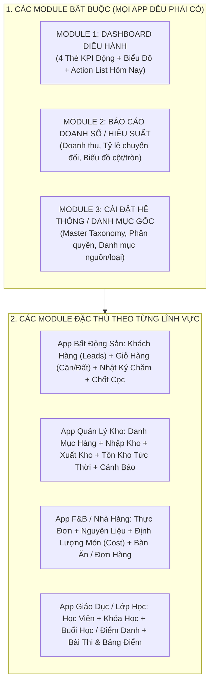

# BỘ QUY CHUẨN KIẾN TRÚC & GIAO DIỆN HÀNG LOẠT WEB APP (MASTER ARCHITECTURAL FRAMEWORK)

> **Tài liệu nền tảng (Foundation Architecture):** Dùng làm tiêu chuẩn bất biến để nhân bản hàng loạt Web App thương mại (BĐS, Kho bãi, Đào tạo, F&B, Bán hàng, Tài chính...) đảm bảo trải nghiệm đồng nhất, chuyên nghiệp như SaaS cao cấp (599k+) và không bị lộn xộn giao diện.

---

## PHẦN 1: MA TRẬN PHÂN CHIA MODULE (BẮT BUỘC vs ĐẶC THÙ)

Mọi Web App được sản xuất ra đều tuân theo cấu trúc **"3 Bắt Buộc + N Đặc Thù"**:

### 1.1. Ba Module BẮT BUỘC (The Mandatory Core)
1. **Module Dashboard Điều Hành (Executive Command Center):**
   - **4 Thẻ KPI động trên cùng:** Luôn trả lời ngay 4 câu hỏi: *Quy mô hiện tại? Việc khẩn hôm nay? Năng lực đáp ứng? Tiền về túi tháng này?*
   - **Widget "Cần làm hôm nay" (Daily Action Queue):** Khách cần gọi, hàng sắp hết date/tồn, lịch học trong ngày... Môi giới/Chủ quán mở app ra là biết ngay phải làm gì, không bị trôi việc.
2. **Module Báo Cáo & Thống Kê (Analytics & Performance):**
   - Không chỉ hiển thị bảng chữ thô, bắt buộc có trực quan hóa: Biểu đồ đường (xu hướng theo ngày/tháng), Biểu đồ cột (so sánh giữa các nhóm), Biểu đồ tròn/thanh (cơ cấu tỷ trọng).
   - Tự động liên kết công thức từ cơ sở dữ liệu nền, không nhập tay số liệu thống kê.
3. **Module Cài Đặt & Danh Mục Nền (Master Taxonomy & Settings):**
   - Nơi người dùng tự thêm bớt danh mục mà không làm vỡ code (VD: Thêm phân khúc BĐS mới, thêm đơn vị tính nguyên liệu mới, cấu hình % hoa hồng mặc định).

---

## PHẦN 2: QUY CHUẨN GIAO DIỆN ADMIN & BẢNG DỮ LIỆU (SAAS STANDARDS)
*(Kế thừa & Chuẩn hóa từ Canonical Policy của Hệ thống)*

### 2.0. Phân Định Trải Nghiệm Riêng Biệt: Mobile View vs Desktop View
Một sai lầm rất lớn của các phần mềm nghiệp dư là ép nguyên xi giao diện Desktop nhiều cột lên màn hình điện thoại khiến người dùng phải kéo ngang ngón tay rất mệt mỏi. Chuẩn SaaS thương mại bắt buộc phải phân tách 2 trải nghiệm độc lập:

1. **Trên Màn Hình Desktop (Màn hình lớn / Laptop):**
   - **Thanh Sidebar cố định bên trái:** Đầy đủ Logo thương hiệu + Tên app + Danh sách menu dọc có chữ và icon. Có nút Hamburger để thu gọn về dạng Icon-only (~64px) khi cần mở rộng diện tích làm việc.
   - **Bảng dữ liệu Master Table (Full-Bleed):** Hiển thị đầy đủ tất cả các cột nghiệp vụ (Mã, Tên, SĐT, Phân loại, Giá trị, Trạng thái, Cột Action 3 chấm rỗng tiêu đề).
   - **Freeze Panes:** Tiêu đề bảng cố định trên đỉnh khi cuộn danh sách hàng trăm dòng.
   - **Drawer trượt:** Bấm xem chi tiết thì Drawer trượt ra từ lề phải (chiếm 450px - 550px), người dùng vừa xem chi tiết vừa đối chiếu bảng dữ liệu bên trái.

2. **Trên Màn Hình Mobile (Điện thoại thông minh):**
   - **Chuyển đổi Bảng sang Dạng Thẻ Thông Minh (Table-to-Card Transformation):**
     - Tuyệt đối **KHÔNG** bắt người dùng vuốt ngang màn hình để tìm cột.
     - Mỗi dòng dữ liệu trên Desktop sẽ tự động chuyển thành **1 Khối Thẻ Gọn Gàng (Compact Mobile Card)**:
       - *Hàng 1:* Mã SKU (font-mono bên trái) + Chấm tròn trạng thái `•` (bên phải).
       - *Hàng 2:* Tiêu đề / Tên khách / Tên sản phẩm (chữ đậm nét, to rõ).
       - *Hàng 3:* 2 thông số cốt lõi nhất (VD: SĐT có nút bấm gọi trực tiếp `tel:` + Giá trị tiền/Khoảng giá).
       - *Góc phải:* Nút 3 chấm (`MoreVertical`) mở Action Sheet thao tác.
   - **Thanh Điều Hướng Di Động (Bottom Navigation Bar / Drawer):**
     - Sidebar bên trái ẩn hoàn toàn. Nút Hamburger ở góc trên mở Drawer trượt ra toàn màn hình.
     - **Thanh Dock dưới đáy (Bottom Dock):** 4 icon chính đặt cố định ở đáy màn hình (ngón tay cái chạm tới được dễ dàng): *[Tổng quan]* - *[Khách hàng]* - *[Giỏ hàng]* - *[Menu]* theo chuẩn app ngân hàng/Fintech.
   - **Nút Hành Động Nổi (Floating Action Button - FAB):**
     - Nút `+ Thêm Mới` trên desktop nằm ở Toolbar, nhưng trên mobile sẽ tự động chuyển thành **Nút tròn nổi cố định ở góc dưới bên phải màn hình (`fixed bottom-20 right-4`)** màu Mint xanh để bấm 1 chạm bằng 1 tay cực nhanh!
   - **Form Nhập Liệu & Chi Tiết:** Tự động mở toàn màn hình (Bottom Sheet trượt từ đáy lên), bàn phím số tự bật khi chạm vào ô SĐT/Giá tiền (`inputmode="numeric"`).

### 2.1. Thanh Công Cụ Module (Single-Row Toolbar)
- **1 Hàng duy nhất (Single-Row Layout):** Toàn bộ: `[Nút Hamburger]` $\rightarrow$ `[Ô tìm kiếm có nút 'x' xóa nhanh]` $\rightarrow$ `[2-3 Dropdown Lọc tinh gọn]` $\rightarrow$ `[Nút hành động chính '+ Thêm mới']` phải nằm trên **cùng một dòng duy nhất** ghim cố định (`sticky top-0 z-30`).
- **CẤM tiêu đề `<h1>` to đùng hay đoạn `
` dài dòng** chèn vào Header làm tụt diện tích hiển thị bảng.

### 2.2. Bảng Dữ Liệu Tệp Liền (Edge-to-Edge Full Bleed Table)
- **CẤM "Lậm Card & Lậm Pill":**
  - Không bọc bảng vào cái hộp bo tròn lơ lửng giữa màn hình xám. Bảng phải tràn viền liền mạch với Header (`Full-Bleed Flat Canvas`).
  - **Triệt tiêu "Hộp kẹo màu mè":** Các cột Mã định danh (`KH-XXXXXX`, `PRD-XXXXXX`), Tên, SĐT, Ngày tháng... hiển thị dạng văn bản phẳng, sạch (Plain Text). Mã ID dùng font `font-mono text-xs font-semibold text-slate-700`. **Tuyệt đối KHÔNG bọc vào pill viền xám hay background lòe loẹt**.
  - **Trạng thái vận hành:** Chỉ dùng chấm tròn tinh tế (`•`) kèm chữ mỏng thanh lịch (VD: `• Đang chăm`, `• Đã cọc`).
- **Cố định tiêu đề bảng (Freeze Panes):** Cuộn danh sách thoải mái, dòng tiêu đề cột (`<th>`) luôn đứng yên trên đỉnh.
- **Không đường kẻ dọc Excel:** Bảng chỉ có đường phân cách ngang mỏng thanh lịch (`border-b border-slate-100`).

### 2.3. Menu Hành Động 3 Chấm (`MoreVertical`) & Chống Click Nhầm
- **Cột ngoài cùng bên phải:** Luôn là cột Action 3 chấm dọc. Tiêu đề `<th>` cột này **bắt buộc để rỗng**, không ghi chữ "Thao tác" hay "Hành động" gây chật chội.
- **CẤM gắn click vào cả dòng `<tr>`:** Người dùng muốn bôi đen copy SĐT hay xem chữ không bị nhảy popup.
- **Mọi thao tác (Xem chi tiết, Sửa, Nhân bản, Xóa vĩnh viễn):** Nằm gọn bên trong Dropdown 3 chấm bo góc mềm mại (`rounded-xl`).

### 2.4. Trải Nghiệm Nhập Liệu & Chi Tiết (Zero Popup Policy)
- **Màn hình Chi tiết (Detail View):** Không dùng Popup modal bé xíu làm tù túng. Dùng **Drawer trượt từ bên phải** hoặc **Màn hình Full Page (Flat Canvas)** giữ nguyên Sidebar.
- Bố cục Key - Value gọn gàng theo lưới 2 hoặc 4 cột, có nút Back `<` quay lại danh sách nhanh chóng.

---

## PHẦN 3: MA TRẬN ỨNG DỤNG CHO DỰ ÁN CRM BẤT ĐỘNG SẢN V1

Áp dụng đúng bộ khung chuẩn trên vào file CRM Bất Động Sản:

| Module | Phân loại | Thành phần bắt buộc theo chuẩn |
| :--- | :--- | :--- |
| **1. Tổng quan** | Bắt buộc | 4 KPI (Khách đang chăm, Lịch hẹn hôm nay, Căn mở bán, Hoa hồng tháng) + Widget nhắc việc hôm nay + Biểu đồ phễu khách. |
| **2. Khách hàng** | Đặc thù | Bảng danh sách Lead (Plain text + font-mono SKU) + Toolbar 1 dòng (Search 'x' + Lọc Trạng thái) + Toolkit 3 chấm (Chi tiết, Sửa, Xóa). |
| **3. Giỏ hàng BĐS** | Đặc thù | Quản lý kho đa phân khúc (Chung cư, Nhà phố, Đất nền, Dự án) + Giá chốt nét + SĐT Đầu chủ (Read-only an toàn). |
| **4. Lịch hẹn & Nhật ký** | Đặc thù | Ghi nhận cuộc gọi, dẫn xem nhà + Đặt lịch Follow-up (tự động đẩy lên Dashboard). |
| **5. Chốt Deal & Hoa hồng** | Bắt buộc (Tài chính) | Khớp nối Khách + Căn $\rightarrow$ Tự động tính tiền hoa hồng thực nhận $\rightarrow$ Biểu đồ doanh thu tháng. |
| **6. Cài đặt danh mục** | Bắt buộc | Tùy chỉnh danh mục Loại BĐS, Nguồn khách, Tỷ lệ hoa hồng mặc định. |

---

## PHẦN 4: NGUYÊN TẮC QUẢN TRỊ DỮ LIỆU & QUY TRÌNH DEPLOY
1. **Dữ liệu thực tế:** Không hardcode dữ liệu giả (Zero Mock Fallback); rỗng thì ghi *"Chưa có dữ liệu"*.
2. **Lưu vĩnh viễn:** Mọi thao tác Thêm, Sửa, Xóa trên Web App bắt buộc gọi API ghi thẳng vào Google Sheet database.
3. **Quản lý phiên bản:** Test trực tiếp trên link deploy mới nhất cho tới khi mượt mà $\rightarrow$ Dọn dẹp bản rác $\rightarrow$ Ghim URL vào `WEB_APP_URL`.
